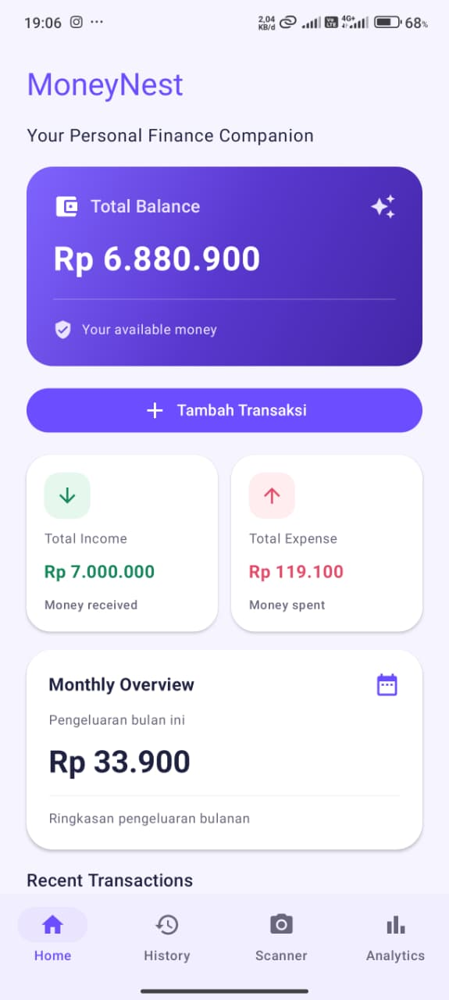
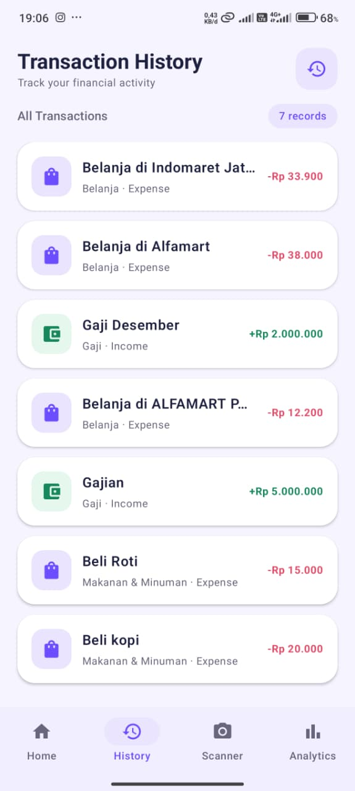
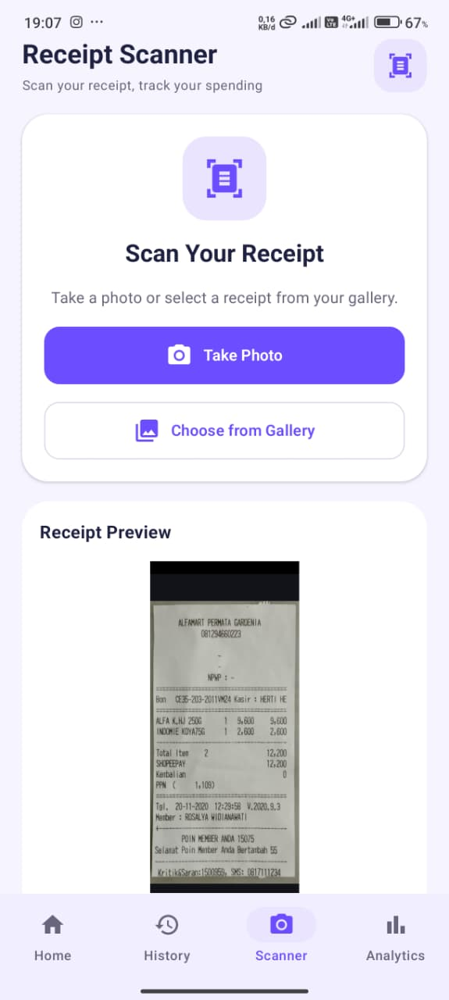

# 💜 MoneyNest — Smart Personal Finance & Receipt Scanner

**MoneyNest** is a native Android personal finance application developed by **Ayu Suningsih** using Kotlin and Jetpack Compose.

MoneyNest helps users manage income, expenses, and daily transactions with an OCR-powered receipt scanner.

## ✨ Features

- **Financial Dashboard** — Monitor balance, income, and expenses.
- **Transaction Management** — Add, edit, and delete transactions.
- **Receipt Scanner** — Scan receipts using Google ML Kit OCR.
- **Smart Receipt Parsing** — Extract store names, dates, items, prices, and discounts.
- **Receipt Review** — Review and edit scanned receipt details.
- **Discount Calculation** — Calculate total discounts and final payments.
- **Transaction History** — View saved transactions and receipt details.
- **Expense Analytics** — Analyze spending by category.
- **Offline Storage** — Save transactions locally using Room Database.

## 📱 App Screenshots

| Dashboard | History |
|:---:|:---:|
|  |  |

| Receipt Scanner | Analytics |
|:---:|:---:|
|  |  |

*Screenshots will appear after the images are uploaded.*

## 🛠️ Tech Stack

| Technology | Purpose |
|---|---|
| Kotlin | Android development |
| Jetpack Compose | User interface |
| Material Design 3 | UI components |
| MVVM | Application architecture |
| Hilt | Dependency injection |
| Room Database | Local storage |
| Coroutines & Flow | Asynchronous and reactive operations |
| Google ML Kit | OCR text recognition |
| CameraX | Camera integration |

## 🏗️ Architecture

MoneyNest follows the **MVVM (Model–View–ViewModel)** architecture.

Main packages:
- `feature/dashboard`
- `feature/transaction`
- `feature/history`
- `feature/scanner`
- `feature/analytics`
- `data/local`
- `data/repository`
- `di`
- `navigation`
- `ui/theme`

## 🚀 How to Run

1. Clone the repository:

   ```bash
   git clone https://github.com/aysns/MoneyNest.git
   ```

2. Open the project in Android Studio.
3. Wait for Gradle synchronization.
4. Connect an Android device or start an emulator.
5. Run the application.

## 🔒 Privacy

MoneyNest stores financial transaction data locally using Room Database. Users can review OCR results before saving transactions.

## 📌 Project Status

**Functional Android Prototype**

Core features have been implemented and manually tested.

## 👩‍💻 Developer

**Ayu Suningsih**

Informatics Engineering Graduate | Android Developer

**GitHub:** [@aysns](https://github.com/aysns)

---

**MoneyNest — Make Every Transaction Count.** 💜
